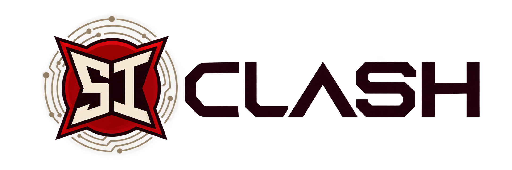

<h1 align="center">Ultra-Low-Power PMU for a Biomedical Sensor Interface</h1>

  <b>Team design project · SI Clash IEEE Design Competition</b> 
  A transistor-level Power Management Unit (PMU) for a battery-powered biomedical sensor interface.

  
  
  
  

  

---

## 📑 Table of contents

1. [📖 Overview](#overview)
2. [👥 Team](#team)
3. [📋 Project description](#project-description)
4. [📄 Reports](#reports)
5. [📬 Contact](#contact)

---

## 📖 Overview

This project is our entry in the **SI Clash IEEE Design Competition**, advised by **Dr. Karim Rawy**. We are designing an ultra-low-power PMU that supplies the power and reference signals for a biomedical sensor interface, starting from the system requirements and going all the way to transistor-level design and verification.

[⬆️ Back to top](#top)

---

## 👥 Team

<table align="center">
  <thead>
    <tr>
      <th align="center">Member</th>
      <th align="center">Role</th>
      <th align="center">Block</th>
    </tr>
  </thead>
  <tbody>
    <tr>
      <td align="center">Mohammed Nasr</td>
      <td align="center"><b>Team Leader</b></td>
      <td align="center">Bias Generator</td>
    </tr>
    <tr>
      <td align="center">Alaa Mostafa</td>
      <td align="center">Member</td>
      <td align="center">Bandgap Reference</td>
    </tr>
    <tr>
      <td align="center">Ahmed Alaa</td>
      <td align="center">Member</td>
      <td align="center">LDO</td>
    </tr>
    <tr>
      <td align="center">Maryam Tamer Mekky</td>
      <td align="center">Member</td>
      <td align="center">Power-On Reset</td>
    </tr>
    <tr>
      <td align="center">Ahmed Othman Ismail</td>
      <td align="center">Member</td>
      <td align="center">DFT</td>
    </tr>
  </tbody>
</table>

[⬆️ Back to top](#top)

---

## 📋 Project description

The full project requirements and specifications are available in [`analog problem.pdf`](./analog%20problem.pdf).

[⬆️ Back to top](#top)

---

## 📄 Reports

Our periodic team reports are available in the [`reports`](./reports) folder.

[⬆️ Back to top](#top)

---

## 📬 Contact

Reach out for collaborations, discussions, or opportunities. 🤝

<table align="center">
  <tr>
    <td align="center" width="120">
      <a href="https://github.com/Mohammed-Nasr-Aldin">
        
         <b>GitHub</b>
      </a>
    </td>
    <td align="center" width="120">
      <a href="https://www.linkedin.com/in/mohammed-nasreldin">
        
         <b>LinkedIn</b>
      </a>
    </td>
    <td align="center" width="120">
      <a href="https://wa.me/201156108363">
        
         <b>WhatsApp</b>
      </a>
    </td>
    <td align="center" width="120">
      <a href="mailto:mohammednasrsmail@gmail.com">
        
         <b>Email</b>
      </a>
    </td>
  </tr>
</table>

© Mohammed Nasr Eldin

